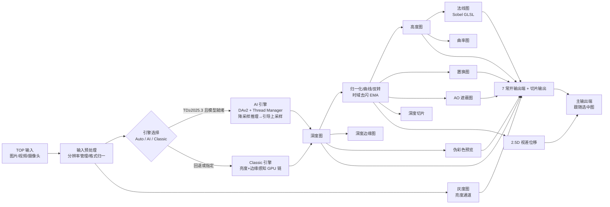

# TD-MapForge 开发指导文档

> TouchDesigner 贴图生成插件：输入任意图片/视频 TOP，一键产出深度图、灰度图及常用三维贴图（高度/法线/置换/AO 等）。
> 设计版本：v3（已冻结） · 目标宿主：TouchDesigner 2025.31550（开发机）· 最低兼容：2025.30000（AI 引擎）/ 任意旧版（Classic 引擎）

---

## 1. 项目概述

### 1.1 目标

做一个**像原生 TOP 一样使用**的 TouchDesigner 插件（单个 `.tox`，Base COMP）：

- 左侧 1 个 TOP 输入端：图片、视频文件、摄像头、任意上游 TOP 均可接入；
- 右侧 8 个 TOP 输出端：1 个主输出（跟随选中图）+ 7 个常开独立输出（深度、灰度、高度、法线、置换、AO、伪彩色预览）；
- 双引擎：AI 真深度（Depth Anything V2）与纯 GPU 近似深度（Classic）可切换、可自动回退；
- 面向**视频后期动效**（质量优先）与**实时交互/演出**（帧率优先）双场景；
- 功能验收通过后发布 GitHub：`TD-MapForge`，MIT 许可，README 与仓库描述中英双语。

### 1.2 非目标（v1 边界）

- 不做点云 / 3D 几何生成（属下游用法，用户可自行接 SOP）；
- 不做渲染导出 / 序列帧输出（用户已有插件解决）；
- 不做独立窗口，自绘预览面板以内嵌 Panel COMP 为限；
- 不附带任何非商用许可的模型文件。

### 1.3 参考实现（调研结论）

| 参考 | 价值 |
|---|---|
| [TouchDesigner/TDDepthAnything（官方）](https://github.com/TouchDesigner/TDDepthAnything) | Depth Anything V2 + Thread Manager + Python Environment Manager 的官方集成范式，AI 引擎直接对标 |
| [Torin Blankensmith DepthAnything 插件](https://derivative.ca/community-post/tutorial/depth-anything-touchdesigner-plugin-tutorial/73018) | 单 tox 拖入即用、Mac/PC 免安装形态的可行性验证 |
| [Derivative 论坛：深度图下游用法](https://forum.derivative.ca/t/using-depth-map-from-tddepthanything-to-generate-3d-geometry-particle-system/713249) | 输出端设计需方便接点云/粒子等下游 |

---

## 2. 冻结需求（v3，经用户三轮确认）

1. **形态**：单 `TD-MapForge.tox`（Base COMP），TOP 进 TOP 出，类似原生 TOP 节点。
2. **输出端**：主输出 ×1（跟随面板/参数选中图）+ 常开独立输出 ×7：深度 / 灰度 / 高度 / 法线 / 置换 / AO / 伪彩色预览；另有深度切片输出（见 §5.6）。
3. **双引擎**：Auto / AI / Classic 三档。
   - AI：Depth Anything V2，Thread Manager 线程化推理，要求 TD ≥ 2025.30000；
   - Classic：亮度 + 边缘感知纯 GPU 近似链，任意旧版 TD 可跑；
   - Auto：自动探测 TD 版本与模型就绪状态，不可用时回退 Classic，面板状态行明示当前实际引擎。
4. **扩展功能（7 项全收，各自独立开关，关闭即不 cook）**：
   ① 视频时域去闪（指数平滑，默认开）② AO 遮蔽图 ③ 曲率图 ④ 深度边缘图 ⑤ 伪彩色预览（viridis/turbo）⑥ 2.5D 视差位移 ⑦ 深度切片分层。
5. **性能**：推理内部分辨率参数化降采样 + 原图引导的边缘保持上采样；跳帧推理参数（每 N 帧推一次）。
6. **自绘预览面板**：原生 Panel COMP 体系，不嵌 Web Render；四段式布局（预览区 → 缩略图条 → 高频控件行 → 状态行）。
7. **模型策略**：默认引导下载 DAv2-Small（Apache 2.0）；高级参数允许用户自放更大模型（非商用许可，插件不附带，用户自负）。
8. **发布**：GitHub `TD-MapForge`，MIT，README 与仓库描述中英双语；模型文件不入库；发布前走安全发布三层检查，届时单独核对授权。
9. **忽略项**：渲染导出。

---

## 3. 技术选型

| 决策点 | 选择 | 理由 / 否决项 |
|---|---|---|
| 插件载体 | 单 `.tox`（Base COMP） | 拖入即用、可版本管理；否决 .toe 模板（不可嵌入复用） |
| AI 推理集成 | ~~Python Environment Manager~~ → `pip --target` 插件私有目录 + torch + Hugging Face（对标 TDDepthAnything） | M2 实测偏离：TD 2025.31550 (x86_64/Rosetta) 内置 Python 3.11 与官方 Env Manager 冲突需重启，改 `arch -x86_64 ... pip --target TD-MapForge-python/` 免重启、依赖随插件目录走；x86_64 mac 轮子天花板 torch 2.2.2 + torchvision 0.17.2 + transformers 4.46.3；备选 ONNX Runtime 保留 |
| AI 线程模型 | Thread Manager 工作线程推理，主线程只取最新结果帧（latest-wins 丢帧策略） | 不阻塞 cook；否决同步推理（卡主线程） |
| 默认模型 | Depth Anything V2 Small（Apache 2.0） | 可商用，GitHub 分发无许可风险；Large 为 CC-BY-NC，仅作"用户自放"高级项 |
| 派生贴图 | 全部 GLSL TOP / 原生 TOP 链 | 全 GPU、跨版本；否决 CPU Python 像素处理（慢且依赖环境） |
| 高度→法线 | Sobel 梯度 GLSL shader | 标准做法，强度参数化 |
| 时域去闪 | 帧间指数平滑（EMA） | v1 够用、成本极低；光流对齐列为后续可选增强 |
| 面板 UI | 原生 Panel COMP / Text COMP / Parameter Execute | 宿主原生管理；否决 Web Render TOP（引入前端运行时、违背原生约束） |
| 贴图开关门控 | 原生 Switch TOP（链输出 / 共享黑色 Constant 二选一） | Switch 只 cook 选中输入，关闭即零开销+黑帧；否决 Parameter Execute DAT 回调门控（M1 实测：脚本化创建后对自定义参数变更不触发回调） |
| 旧版兼容 | 同一 tox 内 Auto 回退 Classic + GLSL 语法保守写法 | 用户无需判断版本；不为旧版单独出分支 |

---

## 4. 系统架构



**数据单一来源**：所有派生贴图只从"归一化深度"（或独立的亮度链）派生，参数页是唯一状态来源；面板控件与原生参数页双向一致。

---

## 5. 模块拆解

### 5.1 输入层
- `In TOP` ×1；记录源分辨率，输出端分辨率 = 源分辨率（AI 内部降采样不影响输出尺寸）。
- 输入断开时各输出端输出黑色常量并保持面板空闲态，不报错刷屏。M1 已实现：`in1` 后经 `in_guard`（Switch）在"输入 / 共享黑色 Constant"间选择，判据 `len(parent().inputs)`（In TOP 的 `.inputs` 不反映 COMP 外部接线，必须用 COMP 的）；断开 → 256×256 黑帧，接通 → 跟随源分辨率（已实测双向）。

### 5.2 AI 引擎（M2）
- **模型管理**：模型存放 `<tox 同级>/TD-MapForge-models/`（已 gitignore；M2 实测回填：运行时根目录 = tox 所在文件夹，经 `externaltox` 解析，开发态回退 `project.folder`）；首次切到 AI 档且模型缺失 → 面板状态行提示 + "下载模型"按钮（pulse）→ 后台线程下载 DAv2-Small → 进度写状态行 → 就绪后自动启用。高级参数 `Custom model path` 允许用户指定自放模型。Python 依赖同理存放 `<tox 同级>/TD-MapForge-python/`（`sys.path.append`，不遮蔽 TD 自带包）。
- **推理管线**：按 `Infer resolution` 参数降采样（Resolution TOP，`outputresolution=resolution`）→ torch 推理（Thread Manager 工作线程）→ 结果经 Script TOP 发布（**`copyNumpyArray` 仅在 onCook 内合法**：callbacks DAT 路由到扩展 `OnScriptCook`，拷贝最新完成帧；M2 实测：cook 外直调写入会被下一帧 cook 重置为 2×2）→ GLSL 联合双边上采样（原图亮度引导，保边缘）→ 输出全尺寸深度。
- **跳帧**：`Skip frames = N` 时每 N 帧推一次，中间帧复用最新结果（经 EMA 链）；N=1 为逐帧（离线质量档）。
- **线程安全**：结果队列长度 1，latest-wins；插件销毁/引擎切换时正确 join 线程，不残留后台任务。
- **失败路径**：Python 环境未就绪 / 模型损坏 / 显存不足 → 状态行给出原因与下一步，自动回退 Classic，不静默黑图。

### 5.3 Classic 引擎（M1）
亮度（Monochrome）→ 边缘感知平滑（bilateral 近似 GLSL）→ 反转/曲线 → 伪深度。参数页与 AI 档共用同一套归一化/曲线控件。**文档与 README 必须明示：Classic 是无语义理解的近似深度，效果以 AI 档为准。**

### 5.4 派生链（两引擎共用，全 GPU）
| 贴图 | 生成方式 | 关键参数 |
|---|---|---|
| 归一化深度 | range remap + gamma 曲线 + 反转（M1 为线性 remap；百分位 clamp 延至 M3/M4 与性能专项一起做） | Range min/max、Curve、Invert |
| 高度图 | = 归一化深度（16-bit 可选） | 位深 |
| 法线图 | 高度 Sobel 梯度 → `n = normalize(-dzdx·s, -dzdy·s, 1)` → RGB | Normal strength |
| 置换图 | 高度归一化输出 | 位深 |
| AO | 高度场多尺度邻域差分平均 | Radius、Strength |
| 曲率图 | 高度 Laplacian，中灰为零点 | Scale |
| 深度边缘 | 深度 Sobel 幅值 + 阈值 | Threshold、Softness |
| 伪彩色 | 深度 → 1D LUT（viridis / turbo） | Palette 菜单 |
| 灰度图 | 源图亮度通道（独立于深度链） | — |

### 5.5 时域去闪
EMA：`out = mix(prev, cur, α)`，α 参数化；输入静态图片时自动旁通。视频场景默认开。光流对齐为 v1 后增强项，不进 v1 范围。

### 5.6 视差位移与深度切片
- **2.5D 视差**：深度驱动 UV 迭代偏移（relief 思路，步数参数化），结果送主输出可选；参数：Amount、Steps、Center。
- **深度切片**：阈值分层输出单层遮罩，`Slice index` + `Slice count` 参数；需要多层时用户多实例或下游复制。

### 5.7 输出层
- 7 常开 + 1 切片 + 1 主输出（`Main output` 菜单选择跟随的图，含视差结果）。
- 贴图开关采用原生 Switch 门控：每链末端 Switch TOP 在"链输出 / 共享黑色 Constant"间选择，Switch 只 cook 选中输入——**功能关闭时该链不 cook 且输出端输出黑帧**（M1 已实测：禁用后输出峰值 0.000）。

### 5.8 自绘预览面板（原生 Panel COMP）
四段式，自上而下：
1. **预览区**：当前选中图等比显示，源/输出分辨率标注；
2. **缩略图条**：各贴图小图横排，点击切换选中（= 主输出跟随项），当前选中态可见；
3. **高频控件行**：引擎三档、反转、强度（法线/AO 随选中图联动）；
4. **状态行**：当前实际引擎、模型状态/下载进度、实测帧率、跳帧档位。

UI 基线（按项目 skill 参考执行）：
- 间距 token：图标-文字 4，同组控件 8，面板内边距 16，分组间 24；
- 热区：主动作 40–44、普通动作 36–40；缩略图视觉小、命中区放大且不覆盖邻居；
- 状态矩阵覆盖 rest / hover / pressed / selected / disabled / busy；模型未下载时 AI 档 disabled 并给出下载引导；
- 面板折叠时停止预览重绘；状态变化不只靠颜色（文字+图标）；
- 宽窗多列、窄窗重排，按实际 Panel 宽高驱动 layout，不按固定截图缩放。

---

## 6. 参数页设计（自定义参数，唯一状态来源）

| 组 | 参数 | 类型 / 默认 |
|---|---|---|
| Engine | Engine mode | 菜单 Auto/AI/Classic，默认 Auto |
| | Infer resolution | 菜单 518/756/1036（短边），默认 518 |
| | Skip frames | int 1–8，默认 2 |
| | Custom model path | str（高级，空 = 默认 Small） |
| | Download model | pulse |
| Depth | Invert | toggle，关 |
| | Range min / max | 0–1，默认 0.02 / 0.98（百分位） |
| | Curve (gamma) | float 0.2–3，默认 1 |
| Temporal | Temporal smooth | toggle，开 |
| | Smooth amount | 0–0.95，默认 0.6 |
| Maps | 各贴图 Enable ×7 | toggle（深度/灰度/高度/法线/置换默认开，AO/伪彩色默认关） |
| | Normal strength | 0.1–10，默认 2 |
| | AO radius / strength | 默认 8 / 1 |
| | Edge threshold / softness | 默认 0.1 / 0.05 |
| | Pseudocolor palette | 菜单 viridis/turbo |
| FX | Parallax enable / amount / steps | 关 / 0.05 / 8 |
| | Slice count / Slice index | 4 / 0 |
| Output | Main output | 菜单（全部图 + Parallax） |
| | Output bit depth | 菜单 8/16-bit，默认 8（置换/高度建议 16） |

---

## 7. 兼容性与性能

- **版本探测**：启动时读 TD build；≥ 2025.30000 开放 AI 档，否则 AI 档 disabled + 状态行说明，Auto 落 Classic。
- **GLSL 保守写法**：不用 2025 新增内建，保证旧版可编译。
- **性能预算（目标值，待实测修正）**：Classic 全链 1080p < 2 ms；AI Small @518 推理 + 上采样 1080p，跳帧 2 时演出场景保 60 fps（Apple Silicon 目标，实测后回填）。
- **M1 实测回填**：Classic 全链 @ 512×512，稳态逐节点 `cookTime` 合计 0.32–0.42 ms/帧（mono 0.13、level 0.06、两个 GLSL 各 0.01–0.04、门控/切换各 0.01–0.06；indicative）。首帧/参数变更后单次 cook 可达 ~3.6 ms（GLSL 编译+纹理分配一次性开销）。门控关闭链经 cookTime 增量实证不 cook（开启后全链恢复 cook）。1080p 实测与 AI 档性能待 M2/M4 专项。
- **M2 实测回填（AI 档，2025.31550 x86_64/Rosetta）**：DAv2-Small CPU 同步推理 @504×504 实测 **0.84–0.92 s/帧**（模型缓存加载 3.7–6.5 s）；Rosetta 下 MPS 不可用（`upsample_bicubic2d.out` 未实现），x86_64 强制 CPU；OMP 默认线程在 Rosetta 下雪崩（5 min 不出帧），固定 `torch.set_num_threads(4)` 后达标；torch 2.2.2 × TD numpy 2.x ABI 不兼容，推理路径全程 `torch.frombuffer` / `untyped_storage().tobytes()` 绕开 numpy 桥。**异步（Thread Manager 工作线程）**：初版在 Rosetta 下被 GIL 竞争饿死（单帧 60 s+ 不完成，主线程帧率同步崩掉）；经 FrameTick 降频（WatchPulses 每帧保脉冲捕获，重活每 3 帧）+ OnScriptCook 版本跳帧（无新结果零拷贝）+ `sys.setswitchinterval(0.002)` 后，实测视频输入异步吞吐 **≈4.5 s/帧（640×360 源）且主线程 58.5 fps 不掉帧**，latest-wins 设计成立。跳帧默认 2；Rosetta 的 4.5 s/帧仍是开发机下限，原生 Apple Silicon（arm64 TD + MPS）实测为 M4 专项，若仍不达标则评估推理子进程化（子进程可用 arm64 Python + MPS，与 TD 进程 GIL 完全隔离）。
- **cook 纪律**：无输入 / 功能关闭 / 面板折叠时对应网络不 cook；尺寸/主题变更才重排；不做空闲 force-cook。

## 8. 项目结构（GitHub 布局）

```
TD-MapForge（repo 根 = 本文件夹内容）
├── plugin/
│   ├── TD-MapForge.tox        # 主交付物（M2 完成后 8454 B）
│   ├── TD-MapForge-models/    # gitignore，模型不入库（tox 同级，DAv2-Small ≈ 100MB 级）
│   └── TD-MapForge-python/    # gitignore，pip --target 依赖目录（torch+transformers ≈ 880MB）
├── examples/                  # 示例 .toe + 演示素材说明
├── docs/                      # 本开发文档 + 后续使用文档
├── README.md                  # 中英双语
├── LICENSE                    # MIT
├── .gitignore                 # TD-MapForge-models/、TD-MapForge-python/、private/、PROJECT.md、TD 缓存等
└── private/                   # gitignore，私有测试素材/日志/证据
```

**分发 sizing 备注（M2 实测回填，M5 待定策略）**：tox 本体仅 KB 级，但运行时依赖 `TD-MapForge-python/`（≈880MB，torch 2.2.2+transformers 4.46.3 x86_64）与模型缓存 `TD-MapForge-models/`（DAv2-Small 首载下载）均不入库。发布形态候选：① 用户按 README 自建依赖（脚本一键 pip --target）；② 发布页附压缩包分流；③ 仅发 tox+在线引导。M5 与用户核对后定。

`PROJECT.md`（本地交接记录）与 `private/` 不入库；发布前三层检查（工作区候选 → Git 索引/历史 → 最终归档），只显式加入公开文件。

## 9. 里程碑

| 里程碑 | 内容 | 出口标准 |
|---|---|---|
| **M1** Classic + 派生链核心 ✅ 已完成 | Classic 引擎、深度/灰度/高度/法线/置换、参数页骨架 | 任意 TOP 输入出 5 图，旧版 TD 可跑 |
| **M2** AI 引擎 ✅ 已完成（2026-10-15，独立复审 ship） | 模型下载引导、线程化推理、引导上采样、Auto 回退、失败路径 | 2025.31550 实测图片+视频；回退路径逐项触发验证 |
| **M3** 扩展功能 | AO/曲率/边缘/伪彩色/视差/切片 + 时域去闪 | 7 项逐项验收，视频样本去闪前后对比 |
| **M4** 面板 + 性能 | 四段式面板、状态矩阵、跳帧/降采样调优 | 面板真实交互验收；性能预算实测回填 |
| **M5** 收尾 + 发布 | TOX 换父容器改名重导入、TOE 冷启动、README 双语、LICENSE、安全发布 | 见 §10；用户授权后建仓推送 |

## 10. 验收标准（两道门）

**门一 · 产物身份**：交付物是 `TD-MapForge.tox` 单文件 Base COMP，TOP 进 TOP 出，8+1 输出端，非 toe、非脚本集合。

**门二 · 当前需求逐项**（每里程碑按最新需求矩阵拆分，证据到项）：
- 每个输出端用真实图片 + 真实视频样本各验一遍，截图/短样本存 `private/` 证据区；
- 面板：真实原生面板检查按钮/缩略图/状态行、disabled/busy 态、宽/窄窗重排；程序化截图单独标注，不以截图冒充交互通过；
- TOX 换父容器且改名后重新导入：核对相对路径、回调、模型路径解析、实际运行；
- 整合 TOE 保存与冷启动分开测；
- AI 回退路径逐项触发（旧版本模拟/模型缺失/环境未就绪），状态行文案与实际引擎一致；
- 私有桥接、测试节点、临时素材不进最终 TOX/TOE；
- 性能实测值回填 §7，不达标项如实标注而非删需求。

**报告口径**：区分"已编译 / 已执行 / 宿主实测 / 未验证"；macOS 实测不代表 Windows 通过，发布页明确已验证平台。

## 11. 许可与合规

- 代码：MIT（repo 根 LICENSE）。
- DAv2-Small：Apache 2.0，可随下载引导使用；README 注明模型来源与许可。
- 更大模型（CC-BY-NC 等）：插件不附带、不诱导；`Custom model path` 由用户自放，README 明示许可责任在用户。
- 发布动作（建仓/推送/Release）按安全发布流程单独核对授权与权限，本文档不构成上传执行。

---

*本文件为开发指导与冻结需求记录；实现阶段的需求变更先更新本文档与 PROJECT.md，再动代码。*
